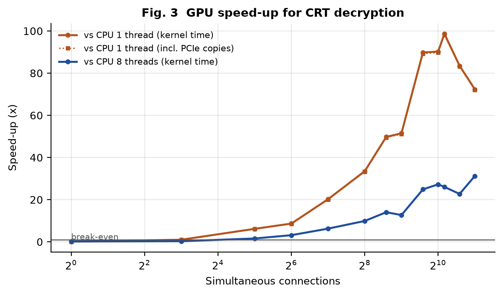
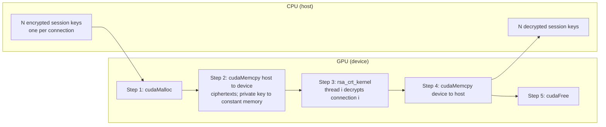
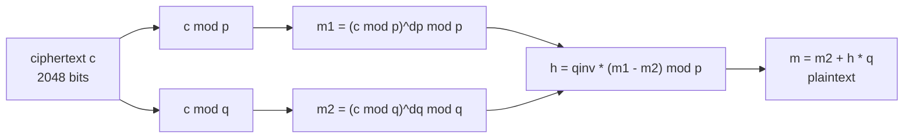
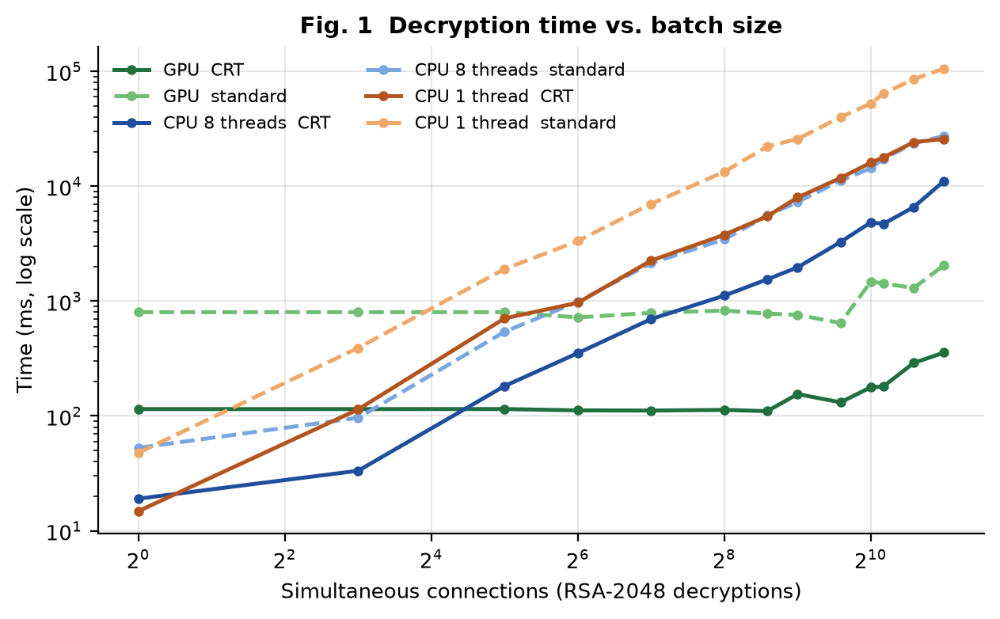
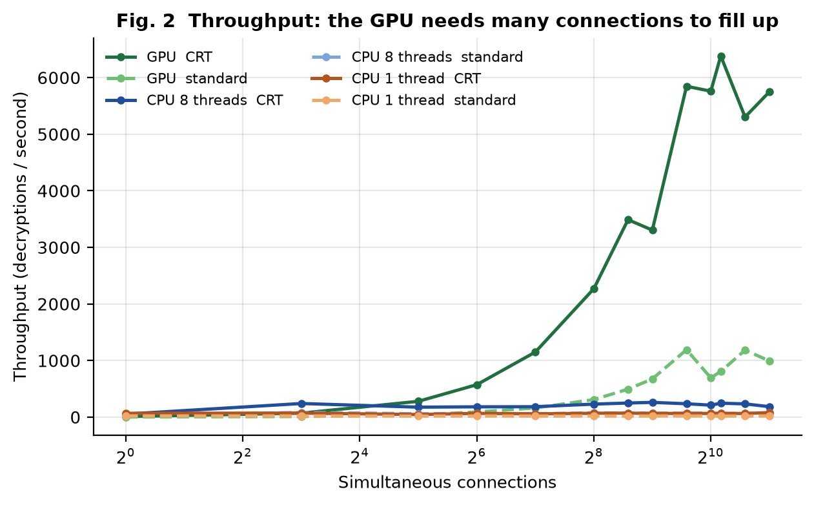
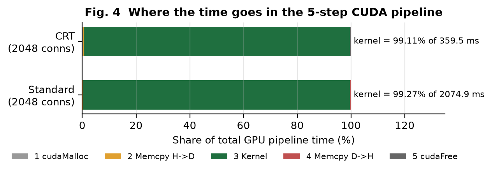

# CUDA RSA-2048: decrypting thousands of connections at once on the GPU

[](https://colab.research.google.com/github/abdullah-habeeb/cuda-rsa/blob/main/RSA_CUDA_Colab.ipynb)


A secure web server has to **decrypt one RSA-2048 session key for every user who connects**. This project
does thousands of those decryptions **at the same time on an NVIDIA GPU, one CUDA thread per connection**,
and compares it fairly with a CPU running the *same* big-integer source code.

> **Course:** Parallel Computing (BCS702), CCA 1, case study: *Cryptography (RSA Encryption / Decryption)*
> **Author:** Abdullah (1BY23CS002), Dept. of CSE, BMS Institute of Technology and Management, 2026-27
> **Guide:** Dr. Mohammed Khurram J, Assistant Professor

---

## Results at a glance

Measured on a laptop GeForce MX250 (an entry-level GPU with 3 SMs), every result checked bit for bit:

| | Result |
|---|---|
| GPU throughput, CRT decryption, 2,048 connections | **5,747 decryptions / s** |
| Peak GPU throughput (1,152 connections) | **6,383 decryptions / s** |
| Speed-up over one CPU core (same code) | **72x** |
| Speed-up over all 8 CPU threads (OpenMP) | **31x** |
| Against OpenSSL 3.5 (hand-tuned assembly) on all 8 threads | **2.4x faster** at the GPU's peak |
| Share of GPU time spent in the kernel (not in copies) | **99.1%** |
| Correctness | **1,000 / 1,000** results confirmed by independent Python big-integer arithmetic |

<p align="center">
  
</p>

---

## Contents

1. [The problem, in plain words](#1-the-problem-in-plain-words)
2. [The idea: one CUDA thread = one connection](#2-the-idea-one-cuda-thread--one-connection)
3. [RSA in 60 seconds](#3-rsa-in-60-seconds)
4. [How the GPU code works](#4-how-the-gpu-code-works)
5. [Results](#5-results)
6. [How we know it is correct](#6-how-we-know-it-is-correct)
7. [Run it yourself](#7-run-it-yourself)
8. [Project structure](#8-project-structure)
9. [Problems we hit and what they taught us](#9-problems-we-hit-and-what-they-taught-us)
10. [Security note](#10-security-note)
11. [References](#11-references)

---

## 1. The problem, in plain words

When you open an `https://` website, your browser invents a random **session key**, locks it with the
server's **public** RSA key and sends it over. Only the server, which holds the matching **private** key,
can unlock it. From then on both sides use that session key.

Unlocking is expensive. RSA-2048 works with numbers that are **617 decimal digits long**, and one
decryption needs about **3,000 multiplications of such numbers**, each followed by a reduction modulo
another 617-digit number. A busy server receives thousands of new connections per second, and every one
of them needs its own decryption.

The decryptions are completely independent of each other, which makes the problem
**embarrassingly parallel**: perfect for a GPU that runs thousands of threads at once.

## 2. The idea: one CUDA thread = one connection



| Part of the problem | How it maps onto CUDA |
|---|---|
| Thousands of connections, no dependencies between them | one thread per connection: `idx = blockIdx.x * blockDim.x + threadIdx.x` |
| Every connection uses the **same** private key | key in **constant memory**: one broadcast serves a whole warp |
| Each thread's 2048-bit working numbers | kept in **registers** (`ptxas` reports 0 bytes of register spills) |
| Ciphertexts in, plaintexts out | "structure of arrays" layout, so a warp's loads and stores are **coalesced** |
| Batch size not a multiple of the block size | `if (idx < count)` boundary check |

## 3. RSA in 60 seconds

| | Formula | Who does it |
|---|---|---|
| Key | n = p x q (two secret 1024-bit primes), e = 65537, d = e^-1 mod (p-1)(q-1) | server, once |
| Encrypt | c = m^e mod n | client (cheap: e is small) |
| Decrypt | m = c^d mod n | server (expensive: d is 2048 bits) |
| Decrypt with CRT | m1 = c^dp mod p, m2 = c^dq mod q, h = qinv (m1 - m2) mod p, **m = m2 + h q** | server, about 4x less work |

The Chinese Remainder Theorem (CRT) version replaces one 2048-bit exponentiation by two 1024-bit ones.
Each half-size multiplication costs a quarter as much and the exponents are half as long, so the work drops
about 4x. This is what real servers (and OpenSSL) do.



## 4. How the GPU code works

All arithmetic lives in [`src/bigint.cuh`](src/bigint.cuh) and is marked `__host__ __device__`: **the exact
same source code** is compiled once for the GPU kernels and once for the CPU baseline. The CPU vs GPU
comparison therefore measures the hardware, not two different implementations.

### 4.1 Big numbers as 64 limbs
A 2048-bit number is an array of **64 unsigned 32-bit "limbs"**, least significant first. Products of two
limbs are computed in 64 bits, so carries are never lost.

### 4.2 Montgomery multiplication (CIOS)
Ordinary modular multiplication needs a division by n, which is very slow for 2048-bit numbers.
**Montgomery multiplication** computes a x b x R^-1 mod n (R = 2^2048) using only multiplications, additions
and word shifts. We use the **CIOS** (Coarsely Integrated Operand Scanning) form from Koç et al.: for each
limb of b, add a x b[i] and immediately cancel the lowest word with a multiple of n. The final
conditional subtraction is **branch-free** (done with bit masks), so all threads execute the same instructions.

### 4.3 Square-and-multiply
c^d is computed left to right over the bits of d: square for every bit, multiply when the bit is 1, about
**2,048 squarings + 1,024 multiplications**. Because every connection is decrypted with the **same d**, all 32
threads of a warp take the same branch at the same time: **zero warp divergence**.

### 4.4 The kernels
[`src/rsa_cuda.cu`](src/rsa_cuda.cu) contains two kernels:

* `rsa_modexp_kernel<KeyMem>`: plain c^e or c^d. A template parameter decides whether the key is read from
  **global, shared or constant memory**, so the memory hierarchy can be compared with identical code.
* `rsa_crt_kernel`: CRT decryption with the key in constant memory (the production path).

```cpp
__global__ void rsa_crt_kernel(uint32_t* __restrict__ out, const uint32_t* __restrict__ in,
                               int first, int count, int stride) {
    const int local = blockIdx.x * blockDim.x + threadIdx.x;
    if (local >= count) return;                            // boundary check
    const int idx = first + local;                         // one thread = one connection

    uint32_t c[NL], m[NL];                                 // NL = 64 limbs, held in registers
#pragma unroll
    for (int l = 0; l < NL; ++l) c[l] = in[(size_t)l * stride + idx];    // coalesced load
    rsa_crt_decrypt<NL>(m, c, c_crt);                      // private key from __constant__ memory
#pragma unroll
    for (int l = 0; l < NL; ++l) out[(size_t)l * stride + idx] = m[l];   // coalesced store
}
```

**Data layout.** Limb `l` of connection `idx` is stored at `in[l * stride + idx]`, so the 32 threads of a
warp read 32 neighbouring words (128 bytes) in one memory transaction.

**Registers decide occupancy.** Fully unrolled 2048-bit arithmetic needs 166 to 211 registers per thread
(see `./rsa_cuda info`), so only 768 (standard) or 1,152 (CRT) threads fit on the MX250 at once. The CRT
kernel's smaller numbers need fewer registers, which is why CRT helps the GPU **more** (5.8x) than the CPU (4.1x).

**Launching in waves.** Each launch covers exactly one "wave" of resident threads, sized with
`cudaOccupancyMaxActiveBlocksPerMultiprocessor`. This keeps every kernel well under the 2-second Windows
display-driver watchdog (TDR) on a laptop GPU.

### 4.5 The CPU baseline
The CPU runs the same `mod_exp` / `rsa_crt_decrypt` functions, on 1 thread or on all 8 threads with
OpenMP. For context, `results/openssl_speed.txt` also records `openssl speed rsa2048` on the same laptop.

## 5. Results

Hardware: **NVIDIA GeForce MX250** (Pascal, compute capability 6.1, 3 SMs, 384 CUDA cores, 2 GB GDDR5) and
**Intel Core i7-10510U** (4 cores / 8 threads), Windows 11 + WSL 2 (Ubuntu), CUDA 11.7, g++ 11.4.
GPU times are kernel time, median of 3 runs after a warm-up.

### E1: time and throughput against the number of connections

| Configuration (2,048 connections) | Time (ms) | Decryptions / s | GPU CRT is faster by |
|---|---:|---:|---:|
| **GPU, CRT** | **356** | **5,747** | - |
| GPU, standard | 2,060 | 994 | 5.8x |
| CPU 8 threads, CRT | 11,126 | 184 | 31.2x |
| CPU 8 threads, standard | 27,408 | 75 | 76.9x |
| CPU 1 thread, CRT | 25,772 | 79 | 72.3x |
| CPU 1 thread, standard | 105,727 | 19 | 296.7x |
| OpenSSL 3.5, 8 threads (reference) | - | 2,663 | 2.4x (at the GPU peak) |

<p align="center">
  
  
</p>

What the curves show:

* **The GPU time is flat until the GPU is full.** Anything from 1 to 1,152 connections takes 110-180 ms,
  because they all run in a single wave. CPU time grows in proportion to the batch.
* **A GPU is a throughput machine, not a latency machine.** For a single connection the GPU is 7.7x
  *slower* than one CPU core (114.7 ms against 14.8 ms). It matches one core at about 8 connections and
  overtakes all 8 CPU threads at about 32.
* **OpenSSL is 11x faster per core** than the portable 32-bit code (hand-written 64-bit assembly), yet the
  MX250's peak of 6,383 decryptions/s is still 2.4x OpenSSL on the whole CPU.
* **OpenMP efficiency:** 8 threads give 3.79x over 1 thread, which is 95% of the 4 physical cores.

### E2: where the time goes (the 5-step pipeline)

| Step (CRT, 2,048 connections, 512 KB each way) | Time (ms) | Share |
|---|---:|---:|
| 1. `cudaMalloc` | 1.12 | 0.3% |
| 2. `cudaMemcpy` host to device | 0.69 | 0.2% |
| 3. **Kernel** | **356.33** | **99.1%** |
| 4. `cudaMemcpy` device to host | 0.66 | 0.2% |
| 5. `cudaFree` | 0.74 | 0.2% |

The workload is **compute-bound**: the PCIe copies do not matter for decryption.

<p align="center">
  
</p>

### E3: where should the key live?

| Key in | Kernel (ms), 1,024 connections, standard | Decryptions / s |
|---|---:|---:|
| global memory | 1,503.7 | 681 |
| shared memory | 1,464.2 | 699 |
| constant memory | 1,473.8 | 695 |

Less than 3% difference: the key is only 776 bytes and every thread of a warp reads the same word at the same
time, which all three memory spaces serve from cache. What mattered for this compute-bound kernel was
keeping the working numbers **in registers** and **coalescing** the input and output.

### E4: threads per block

| Threads per block | Standard (ms) | CRT (ms) |
|---:|---:|---:|
| 32 | 1,470.4 | 180.6 |
| 64 | 1,471.6 | 179.3 |
| 128 | 1,393.3 | 176.2 |
| 256 | 1,274.7 | 257.0 |
| 512 | cannot launch | cannot launch |

At 256 threads the CRT kernel is 43% slower: one block then needs about 43,000 of an SM's 65,536 registers,
so only one block fits per SM (768 resident threads instead of 1,152). Blocks of 512 exceed the register
file entirely.

### E5: encryption with the public key

Encryption uses e = 65537 (17 bits), about 160x less work than decryption. The GPU encrypted **4,096
connections in 23.2 ms** (176,800 per second): 13.6x faster than 8 CPU threads and 56x faster than one core.
With so little arithmetic per byte, the copies now take 38% of the total GPU time: Amdahl's law in action.

All raw numbers are in [`results/`](results) (`e1_scaling.csv` ... `e5_encrypt.csv`, `bench_log.txt`).

## 6. How we know it is correct

`./rsa_cuda verify 1000` encrypts 1,000 random messages and checks every path against the original
plaintext ([log](results/verify_log.txt)):

| Check | Result |
|---|---|
| GPU encryption == CPU encryption | 1000 / 1000 |
| GPU decryption with the key in global / shared / constant memory == original | 1000 / 1000 each |
| GPU CRT decryption == original | 1000 / 1000 |
| CPU CRT decryption == original | 1000 / 1000 |
| Partly filled blocks: batches of 1, 31, 33, 65, 257, 999 | all match |

Then [`tools/verify.py`](tools/verify.py) re-checks every GPU result with **Python's built-in big integers**
(`pow(m, e, n)` and `pow(c, d, n)`), which share no code with the CUDA program:
**1000 / 1000 PASS** in both directions ([log](results/python_verify_log.txt)).

The demo ([log](results/demo_log.txt)) decrypts eight readable session keys (`alice`, `bob`, `carol`, ...)
and adds a **tamper test**: flipping a single bit of one ciphertext produces garbage, as it must.

## 7. Run it yourself

### Option A: Google Colab (no NVIDIA GPU needed on your computer)

1. Click **Open in Colab** at the top of this page (or upload [`RSA_CUDA_Colab.ipynb`](RSA_CUDA_Colab.ipynb)).
2. *Runtime > Change runtime type > T4 GPU*.
3. *Runtime > Run all*.

The notebook writes all source files itself, detects the GPU, compiles, and runs the demo, the
verification suite and the independent Python check. The full benchmark at the end is optional.

### Option B: any Linux machine with the CUDA toolkit

```bash
git clone https://github.com/abdullah-habeeb/cuda-rsa.git
cd cuda-rsa
make ARCH=sm_75            # sm_61 = GTX 10xx / MX250, sm_75 = T4, sm_86 = RTX 30xx, sm_89 = RTX 40xx
./rsa_cuda demo 8          # narrated demo: 8 connections, shows the 5 CUDA steps
./rsa_cuda verify 1000     # correctness suite, writes results/verify_dump.txt
python3 tools/verify.py    # independent check with Python big integers
./rsa_cuda bench           # experiments E1-E5 -> results/*.csv (about 15 minutes on a laptop GPU)
python3 tools/plot.py      # figures -> results/figures/ (needs matplotlib)
```

The first compile takes about a minute: the 2048-bit arithmetic is fully unrolled.

### Option C: Windows with WSL (how the author ran it)

The laptop's driver supports CUDA 11.7 at most, so the build uses a separate CUDA 11.7 + gcc 11 environment
inside WSL ([`build_wsl.sh`](build_wsl.sh)). After building, double-click [`run_demo.bat`](run_demo.bat), or
pass arguments: `run_demo.bat verify 1000`. [`run_bench_wsl.sh`](run_bench_wsl.sh) runs demo, verification and
benchmarks in one go.

### Command reference

| Command | What it does |
|---|---|
| `./rsa_cuda demo [N]` | narrated end-to-end demo with N connections (default 8) and a tamper test |
| `./rsa_cuda verify [N]` | correctness suite on N messages (default 1000) |
| `./rsa_cuda bench` | experiments E1-E5, CSV files in `results/` |
| `./rsa_cuda info` | GPU details and per-kernel registers, spills and occupancy |
| `./rsa_cuda all` | demo + verify + bench (the default) |
| `--block B` | threads per block (default 64) |
| `--chunk C` | threads per launch (default: one full wave of the GPU) |
| `--out DIR` | output folder (default `results`) |

A shortened demo run:

```text
(2) Server decrypts ALL connections at once with its PRIVATE key (CRT): m = c^d mod n
  [Step 1] cudaMalloc   : d_in, d_out = 2048 bytes each (8 x 2048-bit numbers)
  [Step 2] cudaMemcpy H->D: 8 ciphertexts + key (constant memory)
  [Step 3] kernel rsa_crt_kernel<<<grid=1, block=64>>> [decrypt-CRT] -> 64 threads for 8 connections
  [Step 4] cudaMemcpy D->H: 8 results
  [Step 5] cudaFree     : device buffers released

conn  | ciphertext (first 24 hex)  | decrypted plaintext                                                | check
    1 | 0ce0d590d6072820afc7a143.. | conn#0001 user=alice session-key=6280938aaad71e7578bc927ddb9c5598  | OK
    2 | 8425e09949c713d5d78f2d13.. | conn#0002 user=bob session-key=cdf6c4e5f3f8751cb9f5a071caa69c1e    | OK
  ...
DEMO RESULT: 8 / 8 connections decrypted correctly
```

## 8. Project structure

```text
cuda-rsa/
├── src/
│   ├── bigint.cuh           # 2048-bit arithmetic: Montgomery (CIOS), mod_exp, CRT - __host__ __device__
│   ├── rsa_cuda.cu          # kernels, 5-step pipeline, OpenMP CPU baseline, demo/verify/bench/info
│   └── rsa_key.h            # RSA-2048 demo key + Montgomery constants (generated by keygen.py)
├── tools/
│   ├── keygen.py            # deterministic key generator (Miller-Rabin, self-test), standard library only
│   ├── verify.py            # independent check of GPU results with Python big integers
│   ├── plot.py              # figures from results/*.csv
│   └── make_colab_notebook.py   # rebuilds RSA_CUDA_Colab.ipynb from the sources
├── results/
│   ├── demo_log.txt, verify_log.txt, bench_log.txt, python_verify_log.txt, device_info.txt
│   ├── e1_scaling.csv ... e5_encrypt.csv       # raw measurements
│   ├── verify_dump.txt      # 1,000 (plaintext, GPU ciphertext) pairs checked by verify.py
│   ├── key.json             # the demo key as hex (used by verify.py)
│   ├── openssl_speed.txt    # OpenSSL reference on the same laptop
│   └── figures/             # fig1 ... fig6
├── RSA_CUDA_Colab.ipynb     # self-contained Google Colab notebook
├── Makefile                 # make ARCH=sm_XX, make regs, make run
├── build_wsl.sh, run_bench_wsl.sh, run_demo.bat   # helpers for Windows + WSL
└── README.md
```

## 9. Problems we hit and what they taught us

| Problem | What happened | Fix | Lesson |
|---|---|---|---|
| **Toolchain mismatch** | The laptop driver supports CUDA 11.7 at most, but the system gcc 15 is too new for nvcc 11.x | A separate CUDA 11.7 + gcc 11 environment in WSL | Driver, CUDA version and host compiler must match |
| **Compiler crash** | nvcc died with "Segmentation fault" inside `cicc` | The fully unrolled 2048-bit carry chains overflowed its 8 MB stack; the Makefile raises the limit | Heavy unrolling has compile-time costs too |
| **Wrong answers on the GPU only** | CRT decryption was wrong on the GPU but right on the CPU, from the same source | Traced to a mis-compiled loop in NVCC 11.7 (run-time-indexed read-modify-write of a local array); rewrote it fully unrolled | Verify GPU output bit for bit against an independent reference |
| **GPU reset risk** | One wave of the standard kernel takes about 0.8 s, close to the 2 s Windows watchdog | Each launch covers exactly one wave, sized with the occupancy API | Laptop GPUs share time with the display |

The mis-compilation was found because the first wrong limb was always limb 1 while limb 0 was correct, which
pointed at the final step m = m2 + h x q. Writing every intermediate value to memory made the bug disappear,
a classic sign of an optimiser fault. The verification suite caught it before any performance number was trusted.

**Takeaways**

* A single GPU thread is about 8x slower than a CPU core; the GPU wins only through the number of threads
  running at once.
* **Registers**, not memory bandwidth, limited how many threads could run. Choosing a better algorithm
  (CRT) gained more than any memory placement.
* Speed means nothing without correctness: every benchmark run re-checks its own output.

## 10. Security note

This is **textbook RSA** written for teaching parallel computing:

* no OAEP / PKCS#1 padding;
* a **fixed-seed demonstration key**, committed on purpose so that results are reproducible
  (`tools/keygen.py`, seed `1BY23CS002-RSA-CUDA-CCA`);
* not hardened against timing or other side-channel attacks.

Never use this code or this key to protect real data.

## 11. References

1. R. L. Rivest, A. Shamir and L. Adleman, "A Method for Obtaining Digital Signatures and Public-Key
   Cryptosystems," *Communications of the ACM*, 21(2), 1978.
2. P. L. Montgomery, "Modular Multiplication Without Trial Division," *Mathematics of Computation*, 44(170), 1985.
3. Ç. K. Koç, T. Acar and B. S. Kaliski, "Analyzing and Comparing Montgomery Multiplication Algorithms,"
   *IEEE Micro*, 16(3), 1996.
4. J.-J. Quisquater and C. Couvreur, "Fast decipherment algorithm for RSA public-key cryptosystem,"
   *Electronics Letters*, 18(21), 1982.
5. NVIDIA Corporation, *CUDA C++ Programming Guide* and *CUDA C++ Best Practices Guide*, CUDA 11.7.
